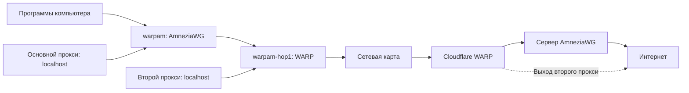

<div align="center">

# WarpAm

**WARP + AmneziaWG для Windows: цепочки туннелей и локальные прокси**

Двойной VPN одной кнопкой, цепочки из отдельных туннелей, SOCKS5/HTTP и автоматический MTU.

[![Release][release-badge]][releases]
[![Downloads][downloads-badge]][releases]


[Скачать](#установка) · [Возможности](#возможности) · [Быстрый старт](#быстрый-старт) ·
[Как это работает](#как-это-работает) · [Вопросы](#частые-вопросы) · [Сборка](#сборка-из-исходников)

</div>

[releases]: https://github.com/Xbit-Ka/WarpAm/releases
[release-badge]: https://img.shields.io/github/v/release/Xbit-Ka/WarpAm?label=%D0%B2%D0%B5%D1%80%D1%81%D0%B8%D1%8F
[downloads-badge]: https://img.shields.io/github/downloads/Xbit-Ka/WarpAm/total?label=%D1%81%D0%BA%D0%B0%D1%87%D0%B8%D0%B2%D0%B0%D0%BD%D0%B8%D1%8F

## Что это

WarpAm основан на [AmneziaWG для Windows](https://github.com/amnezia-vpn/amneziawg-windows-client).
Программа умеет собирать двойной туннель WARP + AmneziaWG, который в списке выглядит как одна запись:

```text
Ваш компьютер ──► Cloudflare WARP ──► сервер AmneziaWG ──► интернет
                  первое звено       второе звено
```

При такой схеме провайдер видит соединение с Cloudflare, Cloudflare видит зашифрованный трафик к серверу AmneziaWG,
а сайты видят адрес сервера AmneziaWG. Это описание пути трафика, а не гарантия полной анонимности.

Порядок подключения звеньев, маршруты, защита от утечек и восстановление после обрывов программа берёт на себя.
Обычные одиночные туннели WireGuard и AmneziaWG тоже поддерживаются.

Начиная с 1.2.0b, отдельные туннели можно связывать настройкой **«Через туннель»**.
Цепочка ограничена четырьмя туннелями; двойной WARP + AmneziaWG считается за два.

## Что нового в 1.2.0b

- Цепочки из отдельных туннелей с автоматическим запуском нижних звеньев и проверкой зависимостей.
- Второй независимый прокси двойного туннеля с выходом через первое звено WARP.
- Вкладка **MTU** с проверкой, пересчётом и отдельными значениями для каждой сети.
- Одновременная работа туннелей с разными ключами, но одинаковыми адресами IPv4 или IPv6.
- Ожидание удаления старого адаптера Windows перед повторным включением.
- Более понятные сообщения о конфликтах ключей, занятых портах и причинах отказа подключения.

Полный список изменений: [релиз WarpAm 1.2.0b](https://github.com/Xbit-Ka/WarpAm/releases/tag/WarpAm-1.2.0b).

## Возможности

### 🔗 Двойной туннель WARP + AmneziaWG

- **Мастер из двух шагов:** выбрать конфиг WARP, затем конфиг AmneziaWG. Получится туннель `warpam`.
- **Одна кнопка на всё:** сначала поднимается первое звено, затем, после его рукопожатия, второе.
  При отключении порядок обратный.
- **Свои маршруты:** сокет звена привязывается к нужному адаптеру через `IP_UNICAST_IF`,
  а к серверу прокладывается отдельный маршрут.
- **Редактирование, переименование и удаление** доступны как у обычного туннеля.
  Настройки первого звена хранятся в том же конфиге со строками `#!`.
- **Один закрытый ключ нельзя использовать в двух работающих туннелях одновременно.**
  При конфликте программа объясняет причину и предлагает переключение с подтверждением.

### 🧩 Цепочки из отдельных туннелей

- Настройка **«Пускать этот туннель через»** находится на вкладке **«Прокси»**, в группе **«Через туннель»**.
- Работает в любом режиме: обычный туннель, туннель с прокси и **«Только через прокси»**.
- Нижние туннели поднимаются автоматически. Верхний ждёт их готовности и не начинает подключение напрямую,
  если нужное нижнее звено не поднялось.
- Кнопка отключения отменяет ожидание нижнего туннеля.
- Перед выключением нижнего или среднего туннеля программа спрашивает о работающих зависимых туннелях.
  После подтверждения они выключаются сверху вниз.
- Если включение новой связки требует остановить другую связку с зависимыми туннелями, сначала появляется вопрос.
- Выбор самого себя, петли и цепочки длиннее четырёх туннелей не допускаются.
  Скрытое первое звено двойного туннеля в списке выбора не показывается.
- Разные ключи с одинаковыми адресами IPv4 или IPv6 могут работать рядом:
  Windows получает свободный адрес, а в пакетах используется адрес из конфигурации.

### 🛡️ Защита от утечек

- **Работает внутри служб:** фильтры Windows Filtering Platform ставятся программой,
  без отдельного процесса защиты.
- **При восстановлении двойного туннеля** защита сохраняется.
- **IPv6:** при отсутствии IPv6-адреса у внутреннего звена цепочки его защита блокирует IPv6.
  Для передачи IPv6 нужны также подходящие маршруты и достаточный MTU.
- **Локальная сеть:** доступ к принтерам, NAS и роутеру можно разрешить в настройках.
- На вкладке **«Настройки»** есть кнопки **«Снять замок сейчас»** и **«Поставить замок сейчас»**.
- В режиме **«Только через прокси»** защита относится к соединениям прокси:
  остальной трафик компьютера продолжает идти обычным путём.

> [!NOTE]
> Проверка внешнего MTU отправляет диагностические ICMP-запросы через сетевую карту.
> Для них предусмотрено отдельное разрешение в фильтрах WarpAm, в том числе при включённой защите.

### 🌐 Локальный прокси

- **SOCKS5 и HTTP на одном порту:** SOCKS5 поддерживает TCP и UDP,
  HTTP поддерживает `CONNECT` и обычные запросы. Протокол определяется при подключении.
- **Вместе с туннелем:** туннель обслуживает компьютер как обычно, а прокси даёт дополнительный вход в него.
- **Только через прокси:** системный DNS не меняется, обычный трафик компьютера не переводится в этот туннель.
  Через него идут программы, настроенные на прокси.
- Соединения привязываются к адаптеру туннеля. DNS-запросы прокси отправляются через него.
- Если туннель пропал, можно отвечать ошибкой или закрывать порт.
  Для коротких перезапусков есть настройка времени ожидания.
- **Доступ:** только этот компьютер (`127.0.0.1`) или ещё локальная сеть.
  Для локальной сети обязательны логин и пароль; хранится хэш пароля, а не сам пароль.
- Правила брандмауэра для LAN-прокси создаются и убираются автоматически.
  Есть защита от подбора пароля.
- Для нового прокси предлагается свободный порт. При запуске проверяются и порты нижних туннелей,
  которые поднимутся вместе с выбранным.

### 🌍 Второй прокси через первое звено

У двойного туннеля можно включить **«Второй прокси через первое звено»** и назначить ему отдельный порт.

- Основной прокси выходит через второе звено AmneziaWG, второй через первое звено WARP.
- Второй прокси не зависит от галочки основного прокси и не требует второго подключения с тем же ключом WARP.
- Слушает **только `127.0.0.1`**, принимает SOCKS5 и HTTP на одном порту.
- DNS-запросы идут через первое звено к `1.1.1.1` и `1.0.0.1`.
- Пока первое звено не поднято, выйти через этот прокси нельзя.

### 📏 MTU для каждой сети

Вкладка **MTU** показывает свой максимум туннеля, значение в цепочке и источник числа.
У двойного туннеля первое и второе звенья показаны отдельно.

- Перед запуском проверяется свой максимум, если для туннеля в этой сети ещё нет результата.
- Значение в цепочке учитывает нижние звенья и накладные расходы протокола.
- После запуска внутренняя проверка может снизить рабочее значение.
  Поправка для конкретной пары туннелей хранится отдельно от собственного максимума верхнего туннеля.
- **«Пересчитать»** проверяет выбранный туннель, **«Проверить все туннели»** запускает общую проверку.
- Свой максимум можно задать вручную. Пересчёт и проверка всех туннелей заменяют ручное число проверенным.
- **«Сбросить MTU»** удаляет сохранённые значения только текущей сети.
- Результаты хранятся в `Data\mtu.json`. Конфигурационные файлы туннелей не переписываются.

> [!WARNING]
> Значение ниже 1280 выделяется красным: IPv6 внутри такого туннеля может не работать.
> Если сервер и запасной адрес не отвечают на ICMP, проверка не может определить максимум.

### ♻️ Восстановление и диагностика

- Сторож следит за звеньями цепочки, сначала пробует новое рукопожатие, затем при необходимости восстанавливает цепочку.
- При старте раньше запрашивается первое рукопожатие; ожидание готовности нижнего звена не блокирует кнопку отключения.
- Перед повторным созданием адаптера программа ждёт удаления старого адаптера Windows.
- При временной занятости `settings.json` сохранение повторяется.
- При ошибке DNS имя сервера запрашивается повторно; может использоваться ранее найденный адрес.
- Окончательные отказы не повторяются несколько раз. Верхний туннель получает причину отказа нижнего.
- Сообщения окна передаются в общий журнал с меткой `[GUI]`.
- Диагностическая подсказка о ключе на другом устройстве является предположением, а не доказанной причиной.

В исходниках 1.2.0b подробный журнал включён: `core/debuglog/switch.go`, `const On = true`.
Он записывается в `Data\debug` с ротацией файлов. Для отключения нужно изменить константу и пересобрать программу.
Перед передачей журналов проверьте, нет ли в них адресов и других данных, которые вы не хотите раскрывать.

### 🚀 Автозапуск

- Служба может поднимать туннель при загрузке Windows, до входа пользователя.
- Можно выбрать: ничего, последний использованный или указанный туннель.
- Ручное отключение отмечается и у зависимых туннелей, чтобы они не включились сами после перезагрузки.
- Выход через трей может отключать туннель и снимать защиту.

### 🔐 Конфиги и папка данных

- Конфиги можно зашифровать через Windows DPAPI. Они привязаны к машине, где были зашифрованы.
- Кнопки **«Зашифровать»** и **«Расшифровать»** действуют и на скрытые звенья.
- Строгие права на папку `Data` оставляют доступ системе и администраторам.
- **«Завершить установку и закрыть от изменений»** шифрует конфиги, ставит строгие права и запрещает снимать их из программы.
  Для отмены этого ограничения требуется удаление программы.
- **«Подготовить папку к переносу»** отключает туннели, удаляет службы, адаптеры и правила LAN-прокси,
  открывает права и закрывает программу. Перед переносом зашифрованных конфигов их нужно расшифровать.
- Испорченный `settings.json` откладывается в сторону, а не затирается настройками по умолчанию.

### 📦 Импорт и экспорт

- Экспорт в ZIP сохраняет двойной туннель вместе со скрытым звеном, настройками и манифестом.
- Архивы WireGuard и AmneziaWG без манифеста тоже поддерживаются.

## Установка

Нужны Windows 10 или 11 и права администратора.
В [релизе 1.2.0b](https://github.com/Xbit-Ka/WarpAm/releases/tag/WarpAm-1.2.0b) опубликованы сборки для **Windows x64**:

| Файл | Назначение |
|---|---|
| `warpam-amd64-1.2.0b.msi` | Установщик для Windows x64 |
| `WarpAm-Portable.zip` | Версия для Windows x64 без MSI-установщика |

### Установщик

1. Скачайте MSI со страницы [Releases][releases] и запустите его.
2. Программа устанавливается в `C:\Program Files\WarpAm`.
3. Для двойного туннеля подготовьте два конфига: Cloudflare WARP для первого звена и AmneziaWG для второго.
   Для одиночного туннеля достаточно одного конфига.

### Portable

1. Распакуйте **всё содержимое** `WarpAm-Portable.zip` в отдельную папку.
2. Оставьте `WarpAm.exe`, `awg.exe` и `wintun.dll` рядом.
3. Запустите `WarpAm.exe` и подтвердите запрос прав администратора.

Portable не требует MSI, но использует службы и сетевые адаптеры Windows.
Перед переносом рабочей папки воспользуйтесь **«Подготовить папку к переносу»**.

### Обновление

- До обновления сделайте резервную копию папки `Data`. Не передавайте её другим людям.
- Зашифрованные конфиги не становятся переносимыми на другой компьютер при копировании папки.
- Если использовалась тестовая сборка с паком 112, после обновления нажмите **«Проверить все туннели»** на вкладке MTU.
  Ранее ошибочно заниженное значение само по себе не исправится.

## Быстрый старт

### Двойной туннель

1. Откройте **«Туннели → Собрать цепочку из двух конфигов (WARP + Amnezia)…»**.
2. Выберите конфиг WARP, затем конфиг AmneziaWG.
3. В списке появится `warpam`. Нажмите **«Подключить»**.
4. Проверьте внешний адрес: должен быть адрес сервера AmneziaWG.

### Прокси для отдельных программ

1. Выберите туннель, откройте вкладку **«Прокси»** и включите прокси.
2. Если через туннель должны ходить только выбранные программы, включите **«Только через прокси»**.
3. Посмотрите фактический порт на вкладке. Подбор начинается с `1080`, но занятые и назначенные другим туннелям порты пропускаются.
4. В программе укажите SOCKS5 или HTTP, адрес `127.0.0.1` и этот порт.

### Туннель через другой туннель

1. Импортируйте конфиги отдельных туннелей.
2. Выберите верхний туннель и на вкладке **«Прокси»** включите **«Пускать этот туннель через»**.
3. Выберите нижний туннель. Не нужно включать прокси только ради этой настройки.
4. Подключите верхний туннель: необходимые нижние звенья поднимутся автоматически.

Например: `WARP → AmneziaWG → ещё один туннель`.
Если нижнее звено не готово, верхнее не должно начинать подключение напрямую.

### Второй выход через WARP

1. Выберите двойной туннель `warpam`.
2. На вкладке **«Прокси»** включите **«Второй прокси через первое звено»** и задайте отдельный свободный порт.
3. Подключите двойной туннель.
4. Для выхода через WARP используйте `127.0.0.1` и порт второго прокси.
   Для выхода через AmneziaWG используйте порт основного прокси, если он включён.

## Как это работает

Пример двойного туннеля с двумя локальными прокси:



В режиме **«Только через прокси»** обычный трафик компьютера не направляется в этот туннель.
На схеме основной и второй прокси используют разные порты; второй доступен только с этого компьютера.

| Компонент | Что делает |
|---|---|
| `WarpAmManager` | Управляет цепочками, защитой, прокси, MTU и восстановлением |
| `WarpAmTunnel$<имя>` | Поднимает адаптер и туннель, настраивает привязку сокета и маршруты |
| Окно и значок в трее | Показывают состояние и передают команды службам |
| `amneziawg-go` | Выполняет протокол AmneziaWG и обфускацию |

Структура репозитория:

```text
amneziawg-go/   движок протокола
core/           конфиги, служба туннеля, маршруты, MTU и фильтры
client/         интерфейс, менеджер, прокси и установщик
```

## Сборка из исходников

Нужны Windows x64, Git for Windows и доступ к интернету для загрузки инструментов и модулей.
Скрипты сборки сами скачивают зависимости и проверяют их контрольные суммы.

Команды для `cmd.exe`:

```bat
git clone https://github.com/Xbit-Ka/WarpAm.git
cd WarpAm\client
build.bat amd64
```

Результат: `client\amd64\WarpAm.exe`, `awg.exe` и `wintun.dll`.
Сохраняйте каталоги `client`, `core` и `amneziawg-go` рядом: Go-модули используют локальные зависимости из этого проекта.
Не подменяйте движок версией из другого репозитория при сборке этого выпуска.

Чтобы собрать MSI после сборки программы, из каталога `client` выполните:

```bat
cd installer
build.bat amd64
```

Установщик появится в `client\installer\dist`.
Его числовая версия берётся из `Number` в `client\version\version.go`.

Скрипты также принимают `x86`, `arm64` и `all`. Наличие этих целей сборки не означает,
что готовые файлы для них опубликованы или проверены в релизе 1.2.0b.

## Частые вопросы

<details>
<summary><b>Зачем нужен WARP перед сервером AmneziaWG?</b></summary>

Провайдер видит соединение с Cloudflare вместо прямого соединения с сервером AmneziaWG.
Сервер AmneziaWG видит адрес выхода WARP. Если прямой доступ к серверу заблокирован,
через WARP он может оставаться доступным.
</details>

<details>
<summary><b>Можно пользоваться без цепочки?</b></summary>

Да. Обычные конфиги WireGuard и AmneziaWG работают отдельно. Для них доступны прокси и автозапуск.
</details>

<details>
<summary><b>Нужен ли второй аккаунт WARP для второго прокси?</b></summary>

Нет. Второй прокси двойного туннеля использует его первое звено.
Запускать отдельный туннель с тем же закрытым ключом одновременно не нужно.
</details>

<details>
<summary><b>Почему IPv6 не работает в длинной цепочке?</b></summary>

Каждый туннель уменьшает доступный MTU. Если значение стало ниже 1280, IPv6 внутри такого туннеля может не работать.
Посмотрите вкладку MTU и сократите цепочку. Одного IPv6-адреса в конфиге недостаточно.
</details>

<details>
<summary><b>Почему после копирования на другой компьютер конфиги не читаются?</b></summary>

DPAPI привязывает зашифрованные конфиги к исходной машине.
Перед переносом расшифруйте конфиги и подготовьте папку к переносу через настройки программы.
</details>

<details>
<summary><b>Можно раздать прокси на другие устройства локальной сети?</b></summary>

Основной прокси можно: выберите **«Ещё и локальная сеть»**, задайте логин и пароль.
Второй прокси через первое звено слушает только `127.0.0.1` и для LAN не предназначен.
</details>

## Благодарности

- [WireGuard for Windows](https://git.zx2c4.com/wireguard-windows/about/): Jason A. Donenfeld и WireGuard LLC
- [AmneziaWG](https://github.com/amnezia-vpn): команда Amnezia VPN
- [Wintun](https://www.wintun.net/)
- [Cloudflare WARP](https://one.one.one.one/)

## Лицензия

MIT, как у исходных проектов. Тексты лицензий лежат в [`client/COPYING`](client/COPYING)
и [`amneziawg-go/LICENSE`](amneziawg-go/LICENSE).

WireGuard является зарегистрированным товарным знаком Jason A. Donenfeld.
Проект не связан с WireGuard LLC, Amnezia VPN и Cloudflare и не одобрен ими.

## Поддержать проект

Буду рад поддержке: [Donation Alerts](https://www.donationalerts.com/r/obichnyi).
